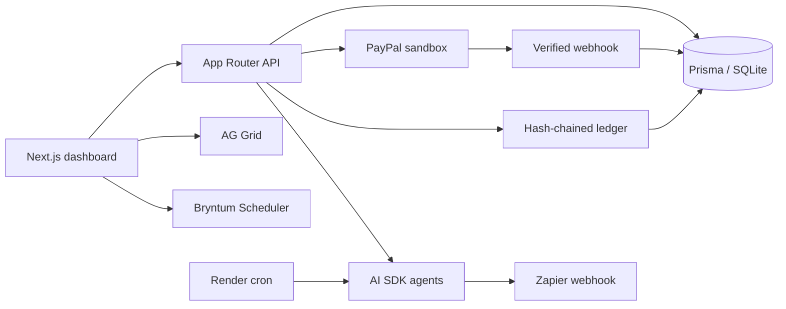

# Chit

Chit is an AI treasurer for rotating savings circles. Members contribute a fixed amount each round and one member receives the pot. The app shows payments, payout order, agent decisions, and a verifiable ledger. It supports fixed rotation and lowest-bid circles. This hackathon prototype uses **PayPal sandbox**, never live money.

## Architecture



SQLite gets the demo running quickly. Prisma isolates database access for a later PostgreSQL migration. Render needs a persistent disk to keep SQLite data across deploys.

## Local setup

Use Node.js 20 or newer.

```bash
npm ci
cp .env.example .env
npm run db:push
npm run db:seed
npm run dev
```

Open http://localhost:3000. The seed creates fixed and bidding circles with six members each, a completed first round, three current payments, an overdue member, and an earlier late payment. `npm run db:seed` resets demo data.

For a credential-free walkthrough, set `DEMO_MODE=true` in `.env` and restart. Demo payments and payouts are explicitly marked simulated in the ledger. Set it to `false` for PayPal sandbox transactions.

## Configuration

| Variable | Purpose |
| --- | --- |
| `DATABASE_URL` | SQLite URL; local default `file:./dev.db` |
| `APP_URL` | Public base URL for PayPal return links |
| `PAYPAL_ENV` | `sandbox` for this demo |
| `PAYPAL_CLIENT_ID`, `PAYPAL_CLIENT_SECRET` | PayPal REST app credentials |
| `PAYPAL_WEBHOOK_ID` | Registered webhook ID |
| `AI_MODEL`, `AI_API_KEY` | OpenAI or compatible model and key |
| `AI_BASE_URL` | Optional compatible API endpoint |
| `ZAPIER_WEBHOOK_URL` | Zapier Catch Hook URL |
| `ADMIN_TOKEN` | Organizer token for protected actions in production |
| `CRON_SECRET` | Token used by Render cron |
| `DEMO_MODE` | `true` enables labeled payment and payout simulation |

The agents request structured JSON through the Vercel AI SDK. Treasurer drafts overdue nudges; Risk scores payment history and updates future fixed rotation; Dispute checks an “I paid” claim against PayPal and ledger evidence. Without model credentials, labeled demo rules keep the walkthrough runnable. Every decision is stored in `AgentAction`.

## Manual integration setup

1. **PayPal:** In the [PayPal Developer Dashboard](https://developer.paypal.com/dashboard/), create a sandbox REST app, buyer account, and recipient account. Copy its client ID and secret to `.env` or Render. Set `APP_URL` to your deployed URL. Register `https://YOUR-APP.onrender.com/api/webhooks/paypal` for `PAYMENT.CAPTURE.COMPLETED`, then copy its webhook ID. Approve a contribution order using the sandbox buyer. Chit captures and verifies the order; repeat webhooks do not duplicate a payment. `@paypal/agent-toolkit` supplies order lookup where supported; REST handles checkout, signature verification, and Payouts.
2. **Payouts:** Ask PayPal to enable Payouts for the sandbox app if it is unavailable. Chit only records a real payout after PayPal reports success. PayPal Orders cannot transfer money to a winner's account without that account's merchant setup, so the fallback is the **labeled `DEMO_MODE` simulation**, not a claimed PayPal payout.
3. **Zapier:** Create a Catch Hook and set `ZAPIER_WEBHOOK_URL`. Connect its payload to WhatsApp, Slack, or email, mapping the member, destination, circle, and message. Nudge decisions are still recorded when the hook is absent.
4. **Bryntum:** The project installs the public Scheduler trial package. Replace it with your licensed package if you have a Bryntum license. AG Grid uses its community React package.
5. **Render:** Push this project to a public GitHub repo and create a Blueprint from `render.yaml`. Set the PayPal, AI, Zapier, and `APP_URL` variables in Render. Set the cron service's `CHIT_BASE_URL` to the web URL. The SQLite disk requires a paid Render web plan. The web service seeds only an empty database; restarts preserve data.

## API and circle rules

`/api/contribute` creates an order; `/api/paypal/return` captures approval; `/api/webhooks/paypal` verifies PayPal's signature and records a contribution. `/api/agents/run` runs Treasurer and Risk. `/api/bid` records eligible bids; `/api/rounds/[id]/close` picks the lowest bid; `/api/payout` pays the winner only after full funding. `/api/disputes` reviews a claim. `/api/demo/pay` operates only in demo mode.

In bidding, past winners cannot bid. A bid cannot discount the pot by more than 30%. The organizer commission is capped at 5% and comes out of the discount; the remaining discount is split among non-winners as next-round contribution credits. Ledger entries form an append-only hash chain. `verifyChain` finds the first broken entry.

## Three-minute demo

1. Show the seeded Sunday Circle, its funded percentage, AG Grid member ledger, Bryntum rotation, and Verified badge.
2. Pay an outstanding contribution with PayPal sandbox or the labeled demo action; refresh the grid and ledger.
3. Run agents. Show Treasurer's overdue nudges and Risk moving a member later in the fixed rotation.
4. Open the bidding circle, submit two eligible bids, close the round, and show the commission and dividend credits.
5. Fund the round and pay the winner. State whether this is a sandbox Payout or a demo simulation.
6. Edit a ledger hash directly in `prisma/dev.db` with SQLite and refresh. The badge changes to Tampered. Reseed afterward.

## Checks

```bash
npm run typecheck
npm run build
```

This is an open hackathon demo. Do not use it for real funds or sensitive financial data. Circle creation and bidding are public demo actions; production organizer operations require `ADMIN_TOKEN`.
